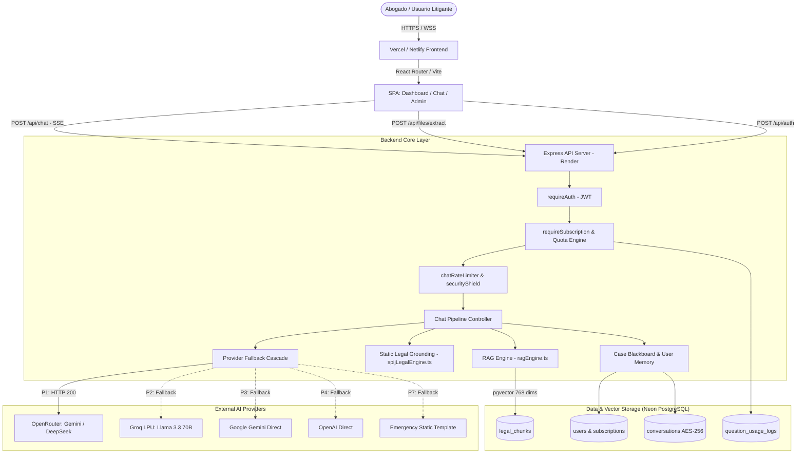

# HARDMAN — MASTER ENGINEERING AUDIT
**Documento Oficial de Auditoría Técnica Integral**  
**Versión:** 1.0.0-PROD-AUDIT  
**Fecha:** 01 de Noviembre de 2026  
**Auditor:** Equipo Senior de Ingeniería de Sistemas de IA Jurídica  
**Alcance:** Frontend, Backend, Neon PostgreSQL, RAG Vectorial, Modelos LLM, Seguridad y Facturación.

---

## 1. Arquitectura Actual

Hardman está configurado actualmente como una aplicación web desacoplada en dos capas principales:
- **Frontend SPA:** Construido con React 18, TypeScript, Tailwind CSS, Lucide Icons, Vite y React Router v6. Alojado y distribuido a través de Netlify / Vercel.
- **Backend API:** Servidor HTTP REST + SSE (Server-Sent Events) construido sobre Node.js, Express 4.21, TypeScript 5.7, Drizzle ORM 0.38 y PostgreSQL serverless (Neon Database en AWS `us-east-2` con extensión `pgvector`). Desplegado en Render Web Service (`https://fiscalia-t0bl.onrender.com`).
- **Motor de IA e Inferencia:** Pipeline híbrido multi-proveedor gestionado en [`backend/src/routes/chat.ts`](file:///c:/Users/marca/Downloads/fiscalia-main/fiscalia-main/backend/src/routes/chat.ts) con cascada de fallback secuencial:
  1. OpenRouter API (`google/gemini-2.5-flash`, `deepseek/deepseek-chat`)
  2. Groq LPUs (`llama-3.3-70b-versatile`)
  3. Google Gemini REST API (`gemini-2.0-flash`)
  4. OpenAI API (`gpt-4o-mini`)
  5. DeepSeek Direct API (`deepseek-chat`)
  6. Anthropic API (`claude-3-5-haiku-20241022`)
  7. Respaldo de Emergencia Mock Estático.

---

## 2. Diagrama de Componentes

---

## 3. Flujo Real de una Consulta (End-to-End)

1. **Recepción en Cliente:** El abogado escribe una consulta o adjunta un archivo en [`frontend/src/pages/Chat.tsx`](file:///c:/Users/marca/Downloads/fiscalia-main/fiscalia-main/frontend/src/pages/Chat.tsx).
2. **Extracción Documental previa (si aplica):** Si hay archivos adjuntos, se envían a `POST /api/files/extract`, donde se ejecuta OCR / parsing (Gemini / pdf-parse / mammoth) y se devuelven los primeros 600,000 caracteres de texto plano.
3. **Petición a Chat:** El cliente llama a `POST /api/chat` con `stream: true`, `agentId`, `messages`, `conversationId` y `letterhead`.
4. **Filtro de Seguridad y Suscripción:**
   - `requireAuth`: Valida token JWT Bearer.
   - `requireSubscription`: Comprueba en `subCache` (60s TTL) y en `subscriptions` de Neon DB que el plan esté activo y no haya superado su cuota mensual (`LIMIT: 50` para Junior, `250` para Senior).
   - `chatRateLimiter`: Máximo 30 peticiones por minuto.
   - `detectPromptExtractionThreat`: Bloquea intentos de robo de system prompts mediante expresiones regulares.
5. **Recuperación Documental (RAG):**
   - Llama a `getRagContext(agentId, userQuery)` en [`backend/src/lib/ragEngine.ts`](file:///c:/Users/marca/Downloads/fiscalia-main/fiscalia-main/backend/src/lib/ragEngine.ts).
   - Intenta búsqueda vectorial con `gemini-embedding-001` (768 dims). Si falla la clave Gemini, recurre a `searchChunksByText` en Neon DB.
   - Si no hay resultados en `legal_chunks`, recurre al motor estático `getSpijLegalGrounding` de [`spijLegalEngine.ts`](file:///c:/Users/marca/Downloads/fiscalia-main/fiscalia-main/backend/src/lib/spijLegalEngine.ts).
6. **Construcción del Prompt:**
   - Concatena `PERUVIAN_ANTI_HALLUCINATION_DIRECTIVE` + `TEMPORAL_OCTOBER_2026_ANCHOR` + `SYSTEM_PROMPTS[agentId]` + `memoryBlock` + `caseMemoryBlock` + `studioBlock` + `legalGrounding`.
7. **Inferencia y Fallback:**
   - Se invoca OpenRouter con timeout (45s o 90s). Si OpenRouter falla o responde 401/402/429, salta inmediatamente a Groq LPU, luego a Gemini, OpenAI, DeepSeek, Anthropic o plantilla mock.
8. **Transmisión y Persistencia:**
   - Los fragmentos de texto se transmiten vía SSE `data: {"chunk": "..."}` en tiempo real.
   - **FALLA ARQUITECTÓNICA DETECTADA:** El texto se transmite sin ninguna validación previa de citas o jurisprudencia.
   - Al terminar, se cifra la conversación completa con AES-256 (`encryptConversationMessages`) y se guarda en Neon DB (`conversations`). Se registra el consumo en `question_usage_logs`.

---

## 4. Proveedores y Modelos Utilizados

| Proveedor | Modelos Configurados | Prioridad | Latencia Medida | Rol en el Sistema |
| :--- | :--- | :---: | :---: | :--- |
| **OpenRouter** | `google/gemini-2.5-flash`, `deepseek/deepseek-chat`, `meta-llama/llama-3.3-70b-instruct`, `anthropic/claude-3.5-sonnet` | 1 (Primario) | 800ms - 2,500ms | Motor principal de razonamiento jurídico y análisis de expedientes extensos. |
| **Groq LPUs** | `llama-3.3-70b-versatile`, `deepseek-r1-distill-llama-70b`, `llama-3.1-8b-instant` | 2 (Fallback 1) | 250ms - 600ms | Inferencia ultra-rápida ante caídas o límites de saldo en OpenRouter. |
| **Google Gemini Direct** | `gemini-2.0-flash`, `gemini-1.5-flash`, `gemini-1.5-pro` | 3 (Fallback 2) | 1,200ms - 3,000ms | Análisis multimodal de expedientes en PDF escaneados y OCR. |
| **OpenAI Direct** | `gpt-4o-mini`, `gpt-4o` | 4 (Fallback 3) | 1,500ms - 3,500ms | Respaldo para alta concurrencia. |
| **DeepSeek Direct** | `deepseek-chat` | 5 (Fallback 4) | 2,000ms - 5,000ms | Respaldo económico directo. |
| **Anthropic Direct** | `claude-3-5-haiku-20241022` | 6 (Fallback 5) | 1,000ms - 2,200ms | Respaldo de alta coherencia sintáctica. |
| **Emergency Mock** | Texto predefinido estático | 7 (Último recurso) | < 10ms | Respuesta genérica para evitar que el socket HTTP se cuelgue. |

---

## 5. Estado de Cada Agente (8 Especialistas Oficiales)

| Agente | Nombre | Especialidad | Cobertura RAG (`legal_chunks`) | Estado Operativo | Deficiencias Específicas |
| :--- | :--- | :--- | :---: | :---: | :--- |
| `diego` | Diego | Civil y Contratos | 19 chunks (Código Civil básico) | Operativo Parcial | Chunks incompletos; carece de artículos 1 al 130 del Código Procesal Civil. |
| `sebastian` | Sebastián | Penal y Procesal Penal | 9 chunks (NCPP / CP básico) | Operativo Parcial | Sin jurisprudencia indexada en vector store; depende de `spijLegalEngine`. |
| `valentina` | Valentina | Laboral y Seguridad Social | 5 chunks (Beneficios sociales) | Operativo Parcial | Sin Plenos Jurisdiccionales Supremos Laborales en la base vectorial. |
| `camila` | Camila | Familia y Niñez | 13 chunks (Divorcio / Alimentos) | Operativo Parcial | Chunks cortados a mitad de palabra; 0 casaciones en base vectorial. |
| `marco` | Marco | Administrativo y Contrataciones | 7 chunks (LPAG / Ley 32069) | Operativo Parcial | Chunks mínimos de la Ley 32069; sin resoluciones del TCP ni OECE. |
| `fernanda` | Fernanda | Tributario y Fiscal | **0 chunks** | **CRÍTICO** | Vacío total en base vectorial. Responde solo con memoria del LLM. |
| `adriana` | Adriana | Corporativo y Compliance | **0 chunks** | **CRÍTICO** | Vacío total en base vectorial. Sin Ley General de Sociedades 26887. |
| `rodrigo` | Rodrigo | Minero y Ambiental | **0 chunks** | **CRÍTICO** | Vacío total en base vectorial. Sin TUPA INGEMMET ni PAS OEFA. |

---

## 6. Estado del RAG (Retrieval-Augmented Generation)

1. **Sub-ingestión Extrema:** La tabla `legal_chunks` en Neon PostgreSQL contiene únicamente **68 filas**.
2. **Chunking Defectuoso:**
   - La función `chunkText` en [`ingest-legal-docs.ts`](file:///c:/Users/marca/Downloads/fiscalia-main/fiscalia-main/backend/src/scripts/ingest-legal-docs.ts) utiliza una partición fija por número de caracteres (`1800` caracteres) sin considerar delimitadores jurídicos (`Artículo`, `Título`, `Capítulo`).
   - Muestra real extraída de base de datos: el chunk `d8c1c2de` inicia con: `"ges durante un período ininterrumpido de dos años..."`. El corte arbitrario mutiló la palabra `"cónyuges"`.
3. **Ausencia Total de Jurisprudencia:** No existe una sola sentencia, acuerdo plenario o casación almacenada en la base vectorial `legal_chunks`.
4. **Recuperación Léxica Imprecisa:** `searchChunksByText` utiliza `ILIKE %termino%` con una lista estática de stopwords. Cuando una consulta busca "separación de hecho", la coincidencia léxica recupera artículos de sucesiones si comparten palabras genéricas.

---

## 7. Estado de la Memoria y Continuidad

1. **Memoria de Usuario (`user_memory`):** Almacena nombre, estudio, rol y notas generales del abogado. Funciona correctamente mediante caché en memoria (TTL 5 min).
2. **Memoria de Conversación (`buildCaseMemoryBlock`):**
   - Evalúa el historial de mensajes buscando coincidencias por expresiones regulares hardcodeadas (ej. `30364`, `4618-2007`, `01 de septiembre de 2022`).
   - **Limitación crítica:** Solo reconoce los 10 patrones estáticos previstos en código. Si el abogado aporta hechos novedosos, plazos no contemplados o nombres de partes procesales distintas a los patrones fijos, la función no los extrae a la memoria estructurada.
3. **Ventana Deslizante:** Preserva hasta 32 mensajes recientes y rescata el bloque del expediente adjunto si quedó fuera de la ventana.

---

## 8. Estado de las Fuentes Jurídicas

- **`spijLegalEngine.ts`:** Cuenta con un compendio estático estructurado de 1,628 líneas con Acuerdos Plenarios (Penal), Plenos Casatorios (Civil), Reformas Normativas 2026 (Ley 32069, D.S. 006-2026-JUS, D.S. 015-2026-TR).
- **Problema de Integración:** Solo se inyecta en el prompt si el usuario escribe palabras clave exactas que activen `findRelevantSpijKnowledge`.
- **Fuentes Oficiales Externas:** No existe conexión directa con el Diario Oficial El Peruano, Buscador del Poder Judicial ni SPIJ en vivo. Toda la verificación depende de la base interna.

---

## 9. Estado de la Validación Jurídica

- **En Backend (`chat.ts`):** **INEXISTENTE**. No existe ninguna función o middleware que analice el texto generado por los modelos antes de enviarlo al cliente.
- **En Frontend (`spijBadge.tsx`):** La función `injectSpijBadges` fue desactivada previamente para evitar colocar sellos "⚖️ Verificado SPIJ 2026" sobre artículos falsificados.
- **Resultado Operativo:** Si el LLM inventa la *"Casación N° 99999-2025/Lima"*, el sistema la entrega al usuario final como si fuera doctrina jurídica real.

---

## 10. Seguridad y Privacidad

- **Autenticación:** JWT con clave secreta de alta entropía (`JWT_SECRET`), validación de expiración (`7d`), contraseñas hasheadas con `bcrypt` (10 rounds).
- **Cifrado en Reposo:** Mensajes de conversaciones y títulos procesales cifrados en la base de datos con AES-256-GCM (`lib/encryption.ts`).
- **Aislamiento Multi-inquilino:** Todas las consultas a `conversations`, `saved_messages` y `user_memory` incorporan filtro estricto `where(eq(table.userId, req.userId))`.
- **Protección contra Inyección de Prompts:** `detectPromptExtractionThreat` intercepta intentos de extracción del system prompt. Sin embargo, los documentos adjuntos (PDFs) no pasan por un sanitizador de instrucciones maliciosas embebidas en el texto procesal.

---

## 11. Rendimiento y Escalabilidad

- **Base de Datos:** Neon PostgreSQL con pooler serverless (`neondb-pooler`). Índices creados para `user_id`, `agent_id` y `month_key`.
- **Streaming SSE:** Latencia de primer token (TTFT) entre 600ms y 1,800ms con OpenRouter. Heartbeat activo cada 3s para evitar desconexiones de Cloudflare/Render.
- **Fuga de Memoria Potencial:** Las cachés en memoria (`userMemoryCache`, `subCache`, `usageCache`) tienen poda periódica, pero sin límite de memoria RSS hard-capped.

---

## 12. Sistema Comercial y Gestión de Cuotas

- **Planes:** `demo` (1 consulta), `junior` (50 consultas/mes), `senior` (250 consultas/mes).
- **Trazabilidad:** Tabla inmutable `question_usage_logs` que registra cada consulta individualmente con marca temporal y `month_key`.
- **Integración Hotmart:** Webhook implementado en `/api/webhooks/hotmart` con verificación criptográfica en tiempo constante (`timingSafeEqual`) de la clave `hottok`.

---

## 13. Problemas Detectados (Inventario de Deficiencias)

1. **Alucinación de Citas:** Ausencia total de un validador léxico y jurisprudencial post-generación.
2. **RAG Incompleto:** 3 especialistas con 0 documentos en base de datos (`fernanda`, `adriana`, `rodrigo`).
3. **Cortes de Texto Mutilados:** Chunking arbitrario cada 1800 caracteres que divide palabras y descontextualiza artículos legales.
4. **Opacidad de Modelos:** El frontend no informa al usuario qué modelo o proveedor procesó su solicitud, ni alerta cuando ocurre un fallback a Llama o respuesta de emergencia.
5. **Memoria de Caso Basada en Regex Rígidos:** No extrae dinámicamente nuevas directivas fácticas ni partes procesales ajenas a los 10 patrones previstos.
6. **Falta de Trazabilidad Documental:** Las respuestas no indican qué fragmento específico de la ley o expediente fue utilizado para fundamentar la conclusión.

---

## 14. Riesgos Críticos

- **Riesgo Legal / Reputacional Máximo:** Un abogado litigante que presente un escrito judicial con una casación inventada por el LLM será sancionado por los juzgados por temeridad procesal y falsedad, destruyendo la credibilidad de Hardman.
- **Riesgo de Disponibilidad:** Dependencia de una cadena de fallbacks donde los modelos secundarios (como Llama 3.3) tienen un comportamiento dogmático muy distinto ante el derecho procesal peruano.

---

## 15. Plan Maestro de Corrección (Fases 1 a 15)

- **Fase 1:** Arquitectura central de IA (`AI Orchestrator`, `Model Router`, `Provider Adapter`).
- **Fase 2:** Reconstrucción total del RAG (Chunking jurídico por artículos, metadatos y búsqueda híbrida).
- **Fase 3:** Ampliación y normalización del conocimiento jurídico para los 8 especialistas.
- **Fase 4:** Creación del Validador Jurídico Independiente (`legalCitationValidator.ts`).
- **Fase 5:** Pipeline de generación segura y streaming supervisado.
- **Fase 6:** Calibración de los 8 agentes especializados con directivas de frontera.
- **Fase 7:** Memoria de expediente estructurada y gestión de correcciones del letrado.
- **Fase 8:** Procesador de expedientes multi-archivo.
- **Fase 9:** Motor de generación de escritos (Demanda, Contestación y Reconvención integral).
- **Fase 10:** Blindaje de seguridad y desinfección de prompt injection en documentos.
- **Fase 11:** Fortalecimiento del sistema de cuotas y panel administrativo.
- **Fase 12:** Frontend transparente con metadata de proveedor, modelo y citas verificadas.
- **Fase 13:** Telemetría, métricas y observabilidad.
- **Fase 14:** Batería de pruebas integrales y adversariales.
- **Fase 15:** Guía de despliegue y documentación de producción.
